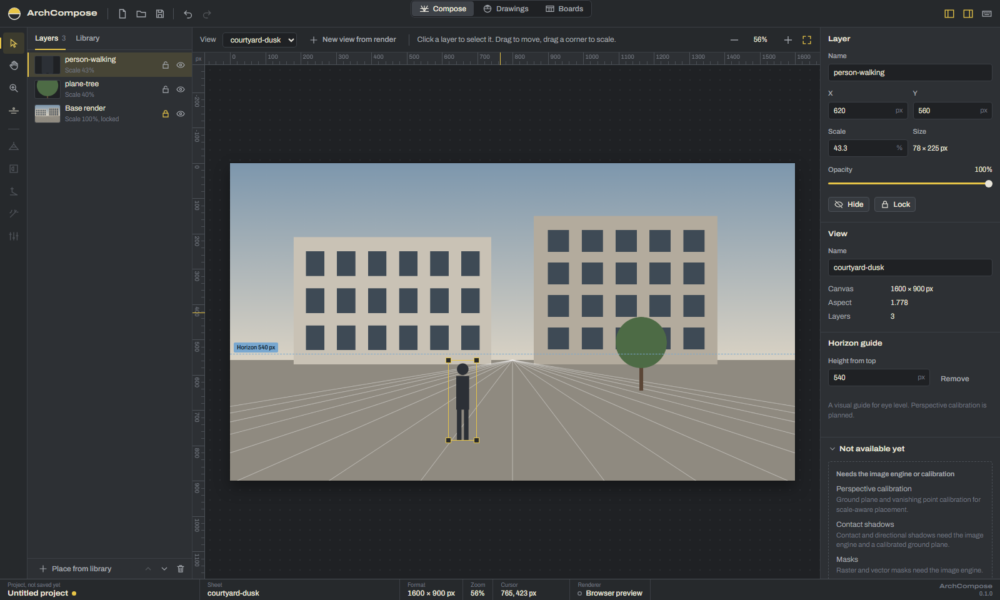
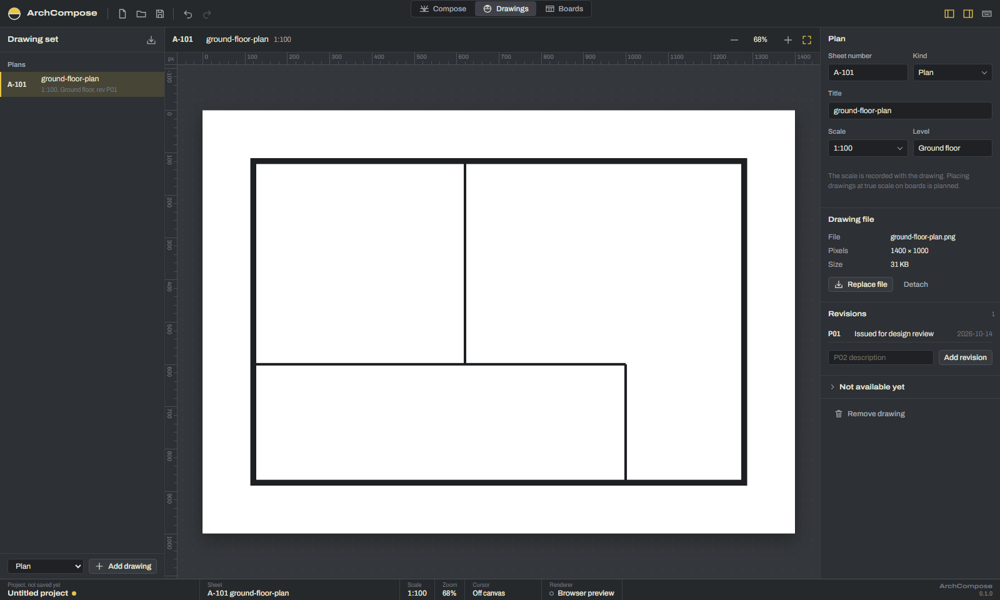
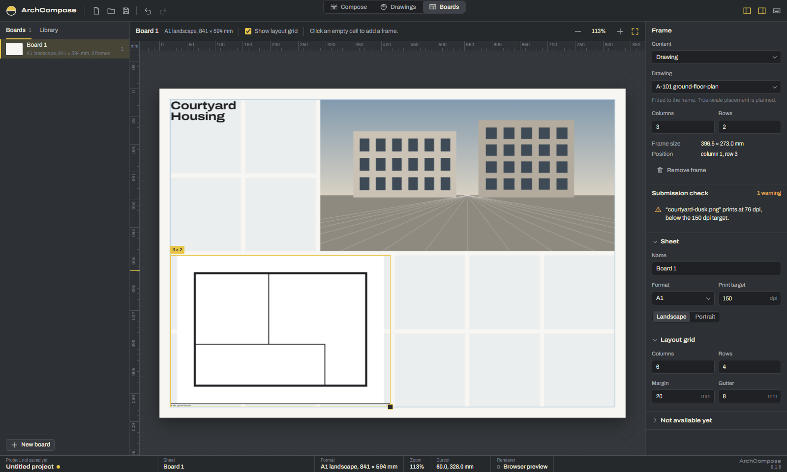

# ArchCompose

A local-first desktop studio for architectural post-production, drawing sets and
presentation boards. Open source, Windows first.



ArchCompose is at its first milestone: a working foundation, not a finished tool. What
works is listed below; everything else is shown in the app as not available yet.

## Workspaces

**Compose** turns a render into a compose view. Import a render, place cut-outs of people,
trees and objects as layers, move and scale them on the canvas, set opacity, order,
visibility and locks, and place a horizon guide at eye level.

**Drawings** keeps the drawing set: plans, sections, elevations, site plans and details,
each with a sheet number (A-101, A-201 …), scale, level, attached drawing file and a
revision log.



**Boards** lays out presentation sheets: ISO A0 to A4 or custom sizes, a layout grid with
margins and gutters, frames holding images, drawings and text, and a submission check that
reports effective print resolution, missing files, empty and overlapping frames.



## What works today

- Projects: new, open, save, save as (`.archcompose`, JSON). Saves are atomic; reopened
  projects reload images from disk and mark missing ones.
- Undo and redo for every edit, with named steps.
- Zoom at the pointer, zoom steps, fit, actual size, pan (hand tool, Space, middle button),
  rulers in pixels or millimetres, cursor position.
- Drop image files on the window to import them into the current workspace.
- Keyboard shortcuts for all main actions (press `?` in the app).

## Not available yet

Perspective calibration, masks, shadows, segmentation, adjustments, image export, PSD,
PDF import, revision comparison, true-scale placement on boards and print PDF export. These
are planned; see [docs/ROADMAP.md](docs/ROADMAP.md). The canvas is a preview drawn by the
system web view, not an export renderer.

## Development

Requirements: Node.js 22 or newer, Rust (stable), and on Windows the WebView2 runtime
(preinstalled on Windows 11).

On Windows, Rust needs a linker. Either install the Visual Studio Build Tools with the
"Desktop development with C++" workload (MSVC, recommended), or use the GNU toolchain
(`rustup default stable-x86_64-pc-windows-gnu`) with a MinGW-w64 distribution such as
WinLibs on `PATH`.

```bash
npm install
npm run tauri dev
```

The frontend also runs in a browser for quick iteration (`npm run dev`, then open
http://localhost:1420). File dialogs fall back to browser file inputs there, and images
cannot be reloaded after reopening a project, because browsers do not expose file paths.

### Checks

```bash
npm run check
```

```bash
npm run build
```

```bash
npx playwright test
```

```bash
cd src-tauri && cargo fmt --all --check && cargo clippy --workspace --all-targets -- -D warnings && cargo test --workspace
```

`npm run check` runs formatting, linting, type checking and unit tests. Playwright needs
its browser once: `npx playwright install chromium`.

The desktop smoke test drives the real app through WebView2's DevTools port and exercises
the Rust commands and disk I/O (PowerShell):

```powershell
$env:WEBVIEW2_ADDITIONAL_BROWSER_ARGUMENTS = "--remote-debugging-port=9222"; npm run tauri dev
```

```bash
npm run smoke:desktop
```

To regenerate the screenshots in `docs/screenshots`, run the Playwright screenshot spec with
`SCREENSHOTS=1` set in the environment.

### Building an installer

```bash
npm run tauri build
```

## Documentation

- [docs/ARCHITECTURE.md](docs/ARCHITECTURE.md): modules, rules and decisions
- [docs/UPSTREAM.md](docs/UPSTREAM.md): PhotoCraft as the future image engine
- [docs/ROADMAP.md](docs/ROADMAP.md): milestones
- [AGENTS.md](AGENTS.md): conventions for contributors and coding agents

## Licence

GNU Affero General Public License v3.0 only (AGPL-3.0-only). See [LICENSE](LICENSE).
