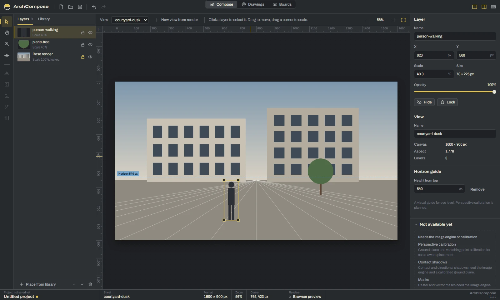
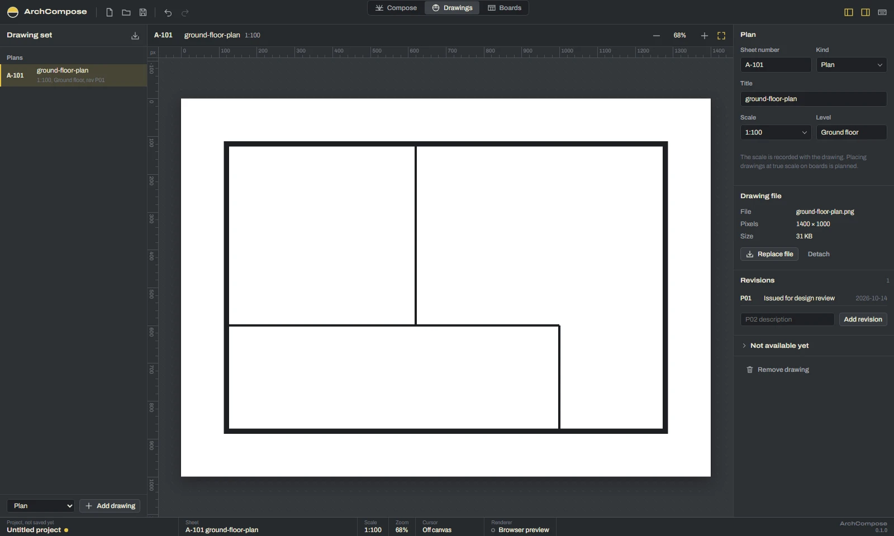
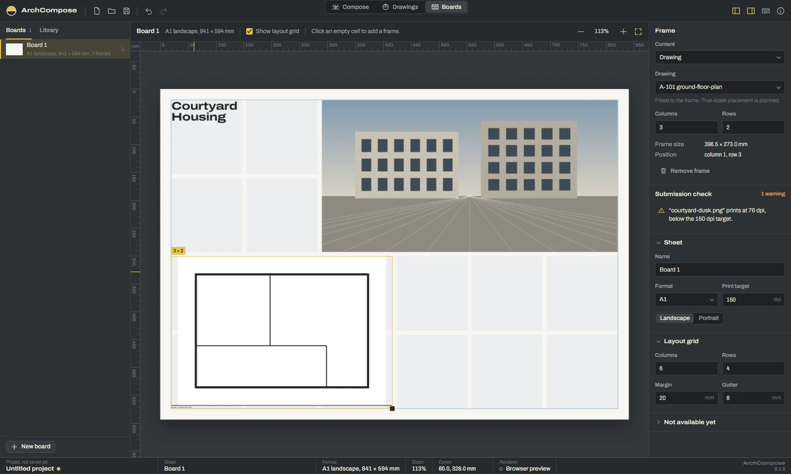

<div align="center">


# ArchCompose

**A local-first desktop studio for architectural post-production, drawing sets and presentation boards.**

[](https://github.com/Luis-0508/ArchCompose/actions/workflows/ci.yml)
[](https://tauri.app/)
[](https://react.dev/)
[](https://www.typescriptlang.org/)
[](https://www.rust-lang.org/)
[](LICENSE)



</div>

## Overview

ArchCompose brings the three things an architecture student or small office prepares for a
review into one desktop app: composed renders, the drawing set, and the presentation boards
they end up on. Projects are plain files on your disk; nothing is uploaded anywhere.

The app is built with Tauri 2, React and TypeScript, with a Rust backend for file access and
image processing. Every edit is a pure function over the document model, which keeps undo,
redo and testing simple. Rendering, export, PSD files and adjustments use library crates of
the open-source [PhotoCraft](docs/UPSTREAM.md) image engine behind ArchCompose's own
interface.

ArchCompose is early: a working foundation, not a finished tool. Features
that are not available yet are listed in the app as such, never as buttons that do nothing.

## Features

**Compose.** Import a render, place cut-outs of people, trees and objects as layers, move and
scale them on the canvas, set opacity, order, visibility and locks, and place a horizon guide
at eye level. Adjust exposure, brightness, contrast and saturation per layer without touching
the image file.

**Export.** Render a compose view at full resolution as PNG with transparency (16-bit when a
source is 16-bit) or as a layered PSD, in the desktop app.

**Image formats.** PNG, JPEG, WebP, AVIF, GIF, BMP and SVG everywhere; in the desktop app
also TIFF, PSD and PSB (composite image), OpenEXR, Radiance HDR, TGA and QOI, converted to
sRGB from their colour profiles.

**Drawings.** Keep the drawing set: plans, sections, elevations, site plans and details, each
with a sheet number (A-101, A-201 …), scale, level, attached drawing file and a revision log.

**Boards.** Lay out presentation sheets in ISO A0 to A4 or custom sizes on a layout grid with
margins and gutters. Frames hold images, drawings and text. A submission check reports
effective print resolution, missing files, and empty or overlapping frames.

**Safe project files.** Projects save as `.archcompose` (JSON) with atomic writes. Reopened
projects reload images from disk and mark missing ones. Your image files are never modified.

**Precise canvas.** Zoom at the pointer, fit and actual size, pan with the hand tool, Space or
the middle button, rulers in pixels or millimetres, and a live cursor readout.

**Undo everything.** Every edit is a named undo step. Keyboard shortcuts cover all main
actions (press `?` in the app). Drop image files on the window to import them.

## Screenshots

<table>
  <tr>
    <td width="50%"></td>
    <td width="50%"></td>
  </tr>
  <tr>
    <td><b>Drawings.</b> Sheet numbers, scales, levels and revisions for every drawing.</td>
    <td><b>Boards.</b> Grid-based sheet layout with a print resolution check.</td>
  </tr>
</table>

## Project status

### Works today

- Compose, Drawings and Boards workspaces as described above.
- New, open, save and save as, with atomic saves and missing-file handling.
- Undo and redo for every edit, keyboard shortcuts, drag-and-drop import.
- Canvas preview through the system web view.
- Desktop app, with the PhotoCraft crates: full-resolution PNG and layered PSD export,
  import of TIFF, PSD/PSB composites, OpenEXR, HDR, TGA and QOI, and per-layer exposure,
  brightness, contrast and saturation previewed by the engine.

### Planned with the PhotoCraft engine

Not implemented yet; see [docs/UPSTREAM.md](docs/UPSTREAM.md).

- Layer masks and selections, filters such as blur and sharpen.
- Importing the individual layers of a PSD (today its composite image is imported).
- Contact and directional shadows, segmentation.

### Planned in ArchCompose itself

- Perspective calibration and scale-aware placement.
- PDF and vector drawing import, revision comparison.
- True-scale placement of drawings on boards and print-ready PDF export.

The canvas is a preview drawn by the system web view; exports are rendered by the engine. The
browser build (`npm run dev`) has no engine and shows engine features as unavailable. The
order of
this work is in [docs/ROADMAP.md](docs/ROADMAP.md); the app's own list of available and
planned features lives in [`src/engine/capabilities.ts`](src/engine/capabilities.ts).

## Quick start

Requirements: Node.js 22 or newer, Rust 1.95 or newer, Git (Cargo fetches the pinned
PhotoCraft crates), and on Windows the WebView2 runtime
(preinstalled on Windows 11).

On Windows, Rust needs a linker. Either install the Visual Studio Build Tools with the
"Desktop development with C++" workload (MSVC, recommended), or use the GNU toolchain
(`rustup default stable-x86_64-pc-windows-gnu`) with a MinGW-w64 distribution such as WinLibs
on `PATH`.

```bash
git clone https://github.com/Luis-0508/ArchCompose.git
```

```bash
cd ArchCompose && npm ci && npm run tauri dev
```

The frontend also runs in a browser for quick iteration (`npm run dev`, then open
http://localhost:1420). File dialogs fall back to browser file inputs there, and images
cannot be reloaded after reopening a project, because browsers do not expose file paths.

## Development

`npm run check` runs formatting, linting, type checking and unit tests:

```bash
npm run check
```

```bash
npm run build
```

Playwright needs its browser once (`npx playwright install chromium`), then:

```bash
npx playwright test
```

Rust checks:

```bash
cd src-tauri && cargo fmt --all --check && cargo clippy --workspace --all-targets -- -D warnings && cargo test --workspace
```

The desktop smoke test drives the real app through WebView2's DevTools port and exercises the
Rust commands and disk I/O. Start the app with remote debugging enabled (PowerShell):

```powershell
$env:WEBVIEW2_ADDITIONAL_BROWSER_ARGUMENTS = "--remote-debugging-port=9222"; npm run tauri dev
```

```bash
npm run smoke:desktop
```

To regenerate the WebP screenshots in `docs/screenshots`, run the Playwright screenshot spec
with `SCREENSHOTS=1` set in the environment.

To build an installer:

```bash
npm run tauri build
```

## Architecture

```text
src/
  model/        Pure document model: types, update functions, history, validation
  state/        Application store and runtime asset cache
  app/          Shell, commands and keyboard shortcuts
  workspaces/   Compose, Drawings and Boards
  ui/           Design system components
  viewport/     Camera math and the shared zoom/pan viewport
  platform/     Desktop (Tauri) and browser adapters
  engine/       Engine boundary: capabilities, preview formats, composition spec
src-tauri/
  src/          Window setup and IPC command wiring
  core/         Tauri-free, unit-tested backend logic (file I/O, engine adapter)
e2e/            Playwright tests against the browser build
```

- [docs/ARCHITECTURE.md](docs/ARCHITECTURE.md): modules, rules and decisions
- [docs/UPSTREAM.md](docs/UPSTREAM.md): the PhotoCraft crates ArchCompose uses, and how
- [docs/ROADMAP.md](docs/ROADMAP.md): milestones
- [docs/GITHUB.md](docs/GITHUB.md): GitHub repository settings and automation
- [AGENTS.md](AGENTS.md): conventions for contributors and coding agents

## Contributing

Contributions are welcome. See [CONTRIBUTING.md](CONTRIBUTING.md) before opening a pull
request.

Issues, pull requests, commit messages, documentation, filenames, and repository-facing
technical text are written in English so contributors can collaborate consistently.

## Security

Please do not report security-sensitive issues publicly. See [SECURITY.md](SECURITY.md).

## License

GNU Affero General Public License v3.0 only (AGPL-3.0-only). See [LICENSE](LICENSE).

ArchCompose includes third-party components under their own licences, among them crates of
PhotoCraft (MIT OR Apache-2.0, used under MIT). See
[THIRD_PARTY_NOTICES.md](THIRD_PARTY_NOTICES.md) and
[THIRD_PARTY_LICENSES.md](THIRD_PARTY_LICENSES.md). ArchCompose is not affiliated with
PhotoCraft or the ArtCraft Team.
